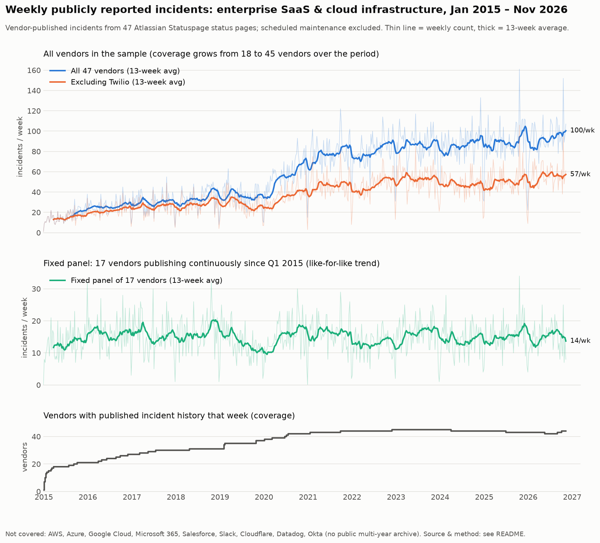

# Weekly SaaS & cloud incidents, 2015–2026

Weekly counts of **publicly reported incidents** from 47 enterprise SaaS and cloud
infrastructure vendors, January 2015 to mid-November 2026. Every count comes from an
incident the vendor posted on its own status page, and every incident links back to it.
None of the counts are estimated or interpolated.



## What it shows

| Year | All 47 vendors (avg/week) | Excluding Twilio | Fixed panel of 17 |
|---|---:|---:|---:|
| 2015 | 17.4 | 15.5 | 13.4 |
| 2016 | 26.1 | 22.1 | 15.8 |
| 2017 | 30.0 | 25.9 | 15.3 |
| 2018 | 34.0 | 28.0 | 16.1 |
| 2019 | 36.2 | 27.6 | 12.9 |
| 2020 | 57.7 | 35.4 | 15.2 |
| 2021 | 78.7 | 46.8 | 16.3 |
| 2022 | 80.3 | 46.7 | 12.5 |
| 2023 | 86.1 | 52.9 | 16.4 |
| 2024 | 86.0 | 46.6 | 13.9 |
| 2025 | 89.5 | 50.2 | 15.4 |
| 2026 | 94.7 | 56.2 | 14.8 |

*(Weeks are Monday–Sunday and grouped by the year the week starts. 2026 runs through the week of 9 Nov.)*

**The headline count rises about 5x, but most of that rise comes from wider coverage,
not from more incidents.** The 17 vendors that have published continuously since Q1
2015 stay flat at roughly 13–16 incidents a week for the whole period. The growth in
the all-vendor line comes from:

1. **More vendors joining the sample.** Status pages that started later (GitHub
   2017, Jira and Confluence 2019, MongoDB, Vercel and Snowflake 2020, DigitalOcean
   2022, and others) add their incidents only from their start date.
2. **Twilio.** Since about 2020 Twilio has posted a separate notice for each
   carrier and country (for example "SMS Delivery Delays to X"). That makes it about
   37% of all non-maintenance incidents here, which is why it has its own line.

## Data

| File | Contents |
|---|---|
| `data/incidents.csv` | One row per incident (50,393 incl. maintenance): vendor, incident id, start date, vendor impact label, title, permalink |
| `data/vendors.csv` | The 47 vendors: status page URL, page creation date, first incident on record |
| `data/weekly.csv` | The plotted weekly series and the number of vendors covered each week |
| `incidents_weekly.png` | The chart |

## Source and method

- **Source.** Each vendor's public Atlassian Statuspage history endpoint,
  `https://<status page>/history.json?page=N`. Each page covers three months and goes
  back to when the vendor's page was created. Vendors are listed in `fetch.py`.
- **Start date.** Taken from the incident's displayed time range. Statuspage files
  each incident under the month it was *resolved*, so the start year is inferred from
  that month. An incident that started in a later calendar month than the one it is
  filed under belongs to the previous year. Display strings that can't be parsed
  produce no record; across all 47 vendors there were none.
- **Excluded.** Scheduled maintenance: impact `maintenance`, or titles containing
  "[Scheduled]", "scheduled maintenance" or "planned maintenance" (13.7k rows).
  Everything else counts, including incidents labelled `none` or `minor`.
- **Deduplication.** By vendor and incident id.
- **Fixed panel.** Vendors whose first incident on record is before 1 Apr 2015 and
  who are still publishing in 2026, excluding Twilio: Bitbucket, Box, CircleCI,
  Cloudinary, Contentful, Elastic Cloud, imgix, LaunchDarkly, Linode, Mailgun, npm,
  Pusher, Segment, Sentry, Smartsheet, Travis CI, Typeform.
- **Validation.** `validate.py` compares parsed dates with the structured
  `/api/v2/incidents.json` (ISO timestamps, latest 50 per vendor). On the 2026-11-21
  run, 2,226 of 2,308 matched exactly and 17 were one day off because of timezones.
  18 differed by more than a day, where the vendor later edited the incident's
  "started" time. 47 recent or still-open incidents had not reached history yet.

## Coverage gaps (please read before citing)

- **Hyperscalers are missing.** AWS, Azure, Google Cloud, Microsoft 365, Salesforce,
  Slack, Cloudflare, Datadog, Okta, Zendesk, GitLab, PagerDuty and Fastly don't use
  Statuspage, or block automated access, or publish only recent or active incidents
  (for example GCP's `incidents.json` currently holds 8 incidents, Slack's history API
  26, Heroku's 10). None of them has a public multi-year incident archive that could
  be counted honestly, so they are left out rather than estimated.
- **This is a sample, not a census.** It covers 47 vendors that are reachable and
  history-bearing. Thousands of SaaS companies exist.
- **Thin histories.** Zoom's endpoint ignores pagination, so only Aug–Nov 2026 is
  available. Mixpanel shows only Oct–Nov 2026, Lucid only 8 incidents, and
  DigitalOcean only since its page was rebuilt in Dec 2022. They are included but add
  almost nothing before those dates.
- **Reporting is a choice.** A status page shows what the vendor chose to publish.
  Thresholds differ between vendors and change over time. A flat count can hide real
  change in either direction, and an empty week means nothing was posted, not that
  nothing broke.
- **Edges.** The first week (29 Dec 2014) holds only 1–4 Jan, and the series stops at
  the last complete week (9–15 Nov 2026).

## Reproduce

```bash
python3 -m venv .venv && .venv/bin/pip install -r requirements.txt
.venv/bin/python fetch.py      # ~3 min, ~1,800 polite requests, writes data/incidents.csv + vendors.csv
.venv/bin/python plot.py       # writes data/weekly.csv + incidents_weekly.png
.venv/bin/python validate.py   # optional date cross-check
```

Vendors keep editing their history, so re-running will change recent weeks slightly.
Data fetched 2026-11-21.
