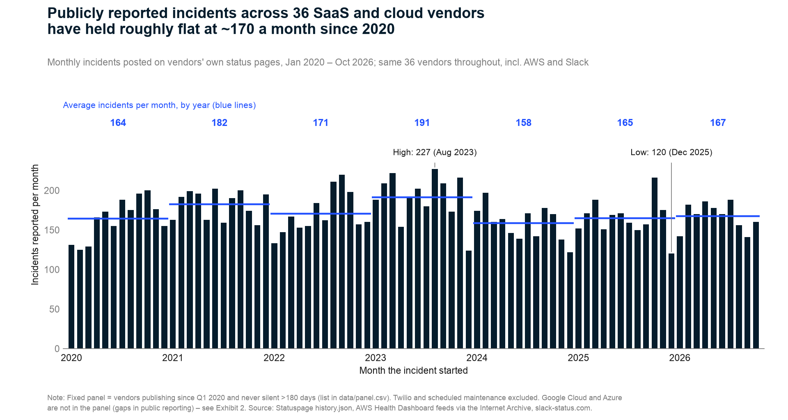
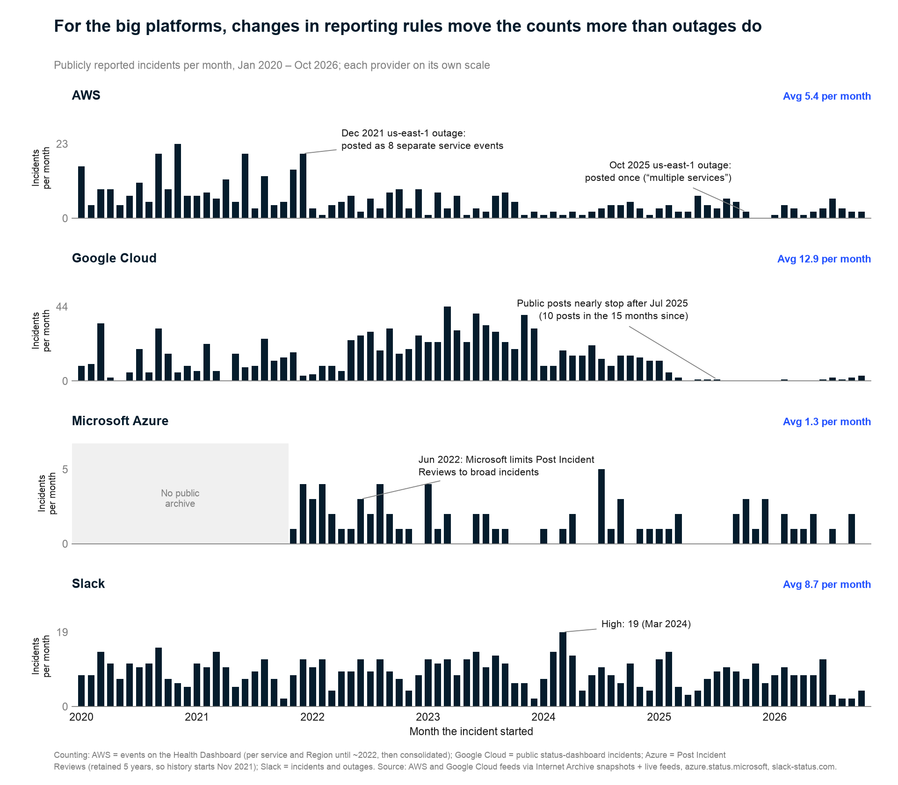

# SaaS & cloud incidents, monthly, 2020–2026

How many incidents do enterprise SaaS and cloud vendors **publicly report**, and is that
number going up? Every count here is an incident a vendor posted on its own status page.
Nothing is estimated or interpolated.

## Exhibit 1: a fixed panel of 36 vendors



The same 36 vendors are counted every month from Jan 2020 to Oct 2026. They report
about **170 incidents a month, with no trend**: 164 a month in 2020, 191 at the 2023 high,
and 167 in 2026 to date.

**Panel:** Asana, AWS, Bitbucket, Box, CircleCI, Cloudinary, Confluence, Confluent Cloud,
Contentful, Dropbox, Elastic Cloud, Figma, GitHub, Gusto, HubSpot, imgix, JFrog Cloud, Jira,
LaunchDarkly, Linode, Mailgun, monday.com, MongoDB Cloud, Netlify, New Relic, npm, Pusher,
Red Hat, Render, Segment, Sentry, Slack, Smartsheet, Trello, Typeform, Vercel.

A vendor is in the panel if it was publishing by Q1 2020, is still publishing in 2026, and
never went more than 180 days without a post. A gap that long means reporting stopped, not
that nothing broke. That rule drops Google Cloud (224-day silence in 2025–26), Loggly and
Travis CI. Twilio is excluded because it posts one notice per carrier and country, which
would make it 46% of the total.

## Exhibit 2: the big platforms



The hyperscalers' public counts mostly follow **changes in how they report**:

- **AWS.** Until about 2022, AWS posted one event per affected service and Region. The
  7 Dec 2021 us-east-1 outage appears as 8 events. From 2022 AWS combines them into one
  "multiple services" post, so the 20 Oct 2025 us-east-1 outage appears once.
- **Google Cloud.** It posted a median of 15 incidents a month (up to 44) on its public dashboard until mid-2025.
  After 18 Jul 2025 it nearly stops: 10 posts in the 15 months since. Archived copies of
  `incidents.json` confirm the feed itself emptied out; this is not a collection gap.
- **Microsoft Azure.** Its public history holds only Post Incident Reviews (PIRs), kept for
  5 years, so it starts in Nov 2021. Since Jun 2022, PIRs cover only broad incidents (stated
  on Azure's status history page).
- **Slack.** Steady at about 9 incidents a month across the whole period.

These four use different counting rules, so compare each one's trend over time, not their
levels against each other. Only AWS and Slack meet the panel rule in Exhibit 1.

## Not covered

Microsoft 365, Salesforce, Cloudflare, Datadog, Okta, Zendesk, GitLab, PagerDuty and Fastly
are left out. None of them has a public incident archive covering 2020–2026: their status
pages are not Statuspage, block automated access, or keep only recent incidents (Salesforce's
API returns about the latest 100). This is a sample of vendors with real public history, not
a census.

## Data

| File | Contents |
|---|---|
| `data/monthly.csv` | Monthly panel total plus AWS, Google Cloud, Azure, Slack |
| `data/panel.csv` | The 36 panel vendors: first and last incident, longest silence, count |
| `data/incidents.csv` | 47 Statuspage vendors, one row per incident since 2015, with permalink |
| `data/incidents_big.csv` | AWS, Google Cloud, Azure, Slack, one row per incident |
| `data/vendors.csv` | Statuspage vendor list with status page URL and page creation date |

## Method

- **Statuspage vendors** (`fetch.py`): every incident from each vendor's public
  `/history.json?page=N`. Statuspage files incidents under the month they were *resolved*, so
  the start year is worked out from that month. `validate.py` checks the parsed dates
  against the API's exact timestamps: 96% match exactly, and most others are timezone
  differences.
- **AWS and Google Cloud** (`fetch_clouds.py`): their official feeds keep only a rolling
  window (AWS `data.json`, then `historyevents.json`; Google `incidents.json`). One Internet
  Archive snapshot per month, plus the live feed, are combined and deduplicated. Each
  snapshot covers 12 months or more, so consecutive snapshots overlap and there are no
  gaps. Snapshots cut off at the archive's 1 MB limit keep every complete record (newest
  first). Old-format Google records that only point to a parent incident ("linked to a
  single Google incident") are dropped, so each incident counts once.
- **Azure:** azure.status.microsoft status history, all pages.
- **Slack:** every slack-status.com day page from 2020-01-01. Incidents and outages count;
  notices are excluded. An incident spanning several days counts once.
- **Excluded everywhere:** scheduled maintenance. Months are grouped by the date the
  incident started. Nov 2026 is incomplete and not plotted.

## Reproduce

```bash
python3 -m venv .venv && .venv/bin/pip install -r requirements.txt
.venv/bin/python fetch.py          # Statuspage vendors (~3 min)
.venv/bin/python fetch_clouds.py   # AWS, Google Cloud, Azure, Slack (~30 min, cached in .cache/)
.venv/bin/python plot_monthly.py   # exhibits + data/monthly.csv, data/panel.csv
.venv/bin/python validate.py       # optional date cross-check
```

Data fetched 2026-11-21. Vendors edit their history, so a later re-run can change recent
months slightly.

## Licence

Code is MIT (see `LICENSE`). Incident records are facts compiled from each vendor's public status page and the Internet Archive; every row in `data/incidents.csv` links to its source.
